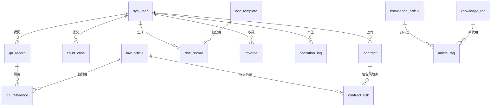

# 职小法 · 数据库设计文档

> 课程设计：Web 应用开发实践 ｜ 数据库：MySQL 8.0 ｜ 引擎：InnoDB ｜ 字符集：utf8mb4
> 建库脚本：`sql/schema.sql` ｜ 测试数据：`sql/data.sql`

---

## 一、设计目标

围绕「职场新人智能法律助手」的业务闭环设计 15 张表，覆盖：

- **用户体系** —— 注册、登录、角色与状态管理
- **法规知识库** —— 法条入库、全文检索、被问答引用
- **核心业务** —— 智能问答、合同审查、案件推演、文书起草
- **普法运营** —— 文章、标签、知识自测
- **通用能力** —— 收藏、操作日志

设计遵循三条原则：

1. **满足第三范式（3NF）**，消除传递依赖与多值属性，详见第四节；
2. **约束下沉到数据库** —— 主键、唯一索引、外键、非空与默认值尽量在 DDL 层表达，不依赖应用层兜底；
3. **索引服务于真实查询** —— 每条索引都能对应到一条具体 SQL，不做「以防万一」的冗余索引。

---

## 二、实体关系总览（ER）



**文字版关系说明：**

| 关系 | 基数 | 外键 | 删除策略 | 说明 |
|---|---|---|---|---|
| 用户 → 问答记录 | 1 : N | `qa_record.user_id` | CASCADE | 用户注销时清理其数据 |
| 用户 → 案件推演 | 1 : N | `court_case.user_id` | CASCADE | 同上 |
| 用户 → 合同 | 1 : N | `contract.user_id` | CASCADE | 同上 |
| 合同 → 风险点 | 1 : N | `contract_risk.contract_id` | CASCADE | 风险点是合同的从属明细 |
| 风险点 → 法条 | N : 1 | `contract_risk.law_id` | SET NULL | 法条被删不影响风险点本身 |
| 问答 ↔ 法条 | M : N | `qa_reference(qa_id, law_id)` | CASCADE | 桥表，附相关度评分 |
| 模板 → 文书 | 1 : N | `doc_record.template_id` | RESTRICT | 已被使用的模板禁止删除 |
| 文章 ↔ 标签 | M : N | `article_tag(article_id, tag_id)` | CASCADE | 桥表 |
| 用户 × 目标 → 收藏 | 多态 | `favorite(user_id, target_type, target_id)` | CASCADE | 见第五节说明 |

---

## 三、表结构清单

共 15 张表。完整字段、类型与注释见 `schema.sql`，此处列出表名、用途与关键设计点。

| # | 表名 | 中文名 | 主键 | 关键设计点 |
|---|---|---|---|---|
| 1 | `sys_user` | 系统用户 | `id` | `role` 区分前台/后台；`password`+`salt` 加盐哈希 |
| 2 | `law_article` | 法规条文 | `id` | ngram 全文索引支撑关键词检索 |
| 3 | `qa_record` | 问答记录 | `id` | 保存问题与系统回答，`status` 区分待答/已答 |
| 4 | `qa_reference` | 问答引用法条 | `id` | 桥表，`(qa_id, law_id)` 唯一，附 `relevance` 相关度 |
| 5 | `court_case` | 案件推演 | `id` | 存推演出的胜诉概率与赔偿区间 |
| 6 | `contract` | 合同 | `id` | 冗余 `risk_level`/`risk_count` 加速列表展示 |
| 7 | `contract_risk` | 合同风险点 | `id` | 逐条问题条款 + 风险说明 + 修改建议 |
| 8 | `doc_template` | 文书模板 | `id` | `code` 唯一；正文用 `${字段}` 占位 |
| 9 | `doc_record` | 生成文书 | `id` | 存填写参数 JSON 与渲染后正文 |
| 10 | `knowledge_article` | 普法文章 | `id` | ngram 全文索引；`status` 区分草稿/发布 |
| 11 | `knowledge_tag` | 标签字典 | `id` | `name` 唯一 |
| 12 | `article_tag` | 文章标签关联 | `id` | 桥表，`(article_id, tag_id)` 唯一 |
| 13 | `quiz_question` | 自测题 | `id` | 四选项 + 正确答案 + 解析 |
| 14 | `favorite` | 收藏 | `id` | 多态关联，`(user_id, target_type, target_id)` 唯一 |
| 15 | `operation_log` | 操作日志 | `id` | 记录用户、动作、URI、IP、耗时、状态码 |

### 关键字段说明

**`sys_user.password` / `salt`**

不存明文密码，只存 `SHA-256(salt + 明文)` 的 64 位十六进制摘要，每个用户独立随机盐（16 字节）。
这样即使数据库泄露，也无法通过彩虹表批量还原密码；同一明文在不同用户下摘要不同。

**`qa_reference.relevance`**

问答与法条是多对多关系，且每条引用有强弱之分（召回排序越靠前相关度越高），
因此不能把「引用的法条」塞进 `qa_record` 的某个字段，必须独立成桥表并把相关度作为桥表属性。

**`contract.risk_level` / `risk_count`**

这两个字段可以由 `contract_risk` 聚合算出，属于**有意的反范式设计**：
合同列表页需要按风险等级排序/筛选，若每次都用子查询聚合，列表查询会退化成两次全表扫描。
权衡后选择在写入时一并维护（与风险点明细同事务），换列表查询的性能。
**这也是本设计唯一偏离严格范式的地方，仅用于读多写少的统计型字段，且有一致性保障。**

---

## 四、范式合规性说明（≥ 3NF）

### 1NF：属性原子性

- 所有字段均为不可再分的原子值；
- **没有把多值属性存成逗号串**：
  - 文章标签用 `knowledge_tag` + `article_tag` 两张表建模，而不是 `tags VARCHAR(200)` 存 `"试用期,工资"`；
  - 问答引用的法条用 `qa_reference` 建模，而不是把法条 ID 拼成字符串。

### 2NF：消除部分依赖

- 所有表均使用**单一代理主键**（自增 `id`），不存在复合主键，因此不存在非主属性对主键一部分的依赖；
- 两张桥表虽然语义上是复合唯一键，但仍使用代理主键 `id`，并把 `(a_id, b_id)` 建成**唯一索引**——
  既保证业务唯一性，又避免复合主键带来的部分依赖风险。

### 3NF：消除传递依赖

逐表核查，非主属性之间不存在函数依赖。举例说明三个典型场景：

| 场景 | 若违反 3NF 会怎样 | 本设计的做法 |
|---|---|---|
| 问答记录存「提问人昵称」 | `nickname` 依赖 `user_id`，而 `user_id` 依赖主键 → 传递依赖；用户改名后历史记录全部要改 | `qa_record` 只存 `user_id`，昵称在查询时 JOIN `sys_user` 得到 |
| 风险点存「法规名称」 | `law_name` 依赖 `law_id` → 传递依赖 | 只存 `law_id`，展示时 JOIN `law_article` |
| 文章存「分类名」字典 | 若分类有独立属性（描述、排序）则需拆表 | 分类只是单一枚举值，无独立属性，保留为列；标签有独立属性需求，故拆表 |

**关于 `sys_user.role` 不单独拆表：**
管理员相比普通用户没有额外属性（不需要 `admin` 表存部门、权限级别等），
拆表会形成 1:1 关系并把 `role` 换成 `admin_id`，反而引入新的传递依赖与连接开销，
因此按 3NF 的判断标准保留为列。

### 唯一索引保证的业务约束

| 索引 | 表 | 保证的约束 |
|---|---|---|
| `uk_user_username` | `sys_user` | 用户名唯一 |
| `uk_user_email` | `sys_user` | 邮箱唯一（允许多个 NULL） |
| `uk_qa_law` | `qa_reference` | 同一问答不重复引用同一法条 |
| `uk_template_code` | `doc_template` | 模板编码唯一 |
| `uk_tag_name` | `knowledge_tag` | 标签名唯一 |
| `uk_article_tag` | `article_tag` | 同一文章不重复打同一标签 |
| `uk_fav_user_target` | `favorite` | 同一用户不重复收藏同一对象 |

---

## 五、多态关联的处理（`favorite` 表）

`favorite` 需要同时收藏问答（`QA`）、文章（`ARTICLE`）、法条（`LAW`）、文书（`DOC`）四类对象，
这属于**多态关联**，无法用单一外键表达。三种可选方案：

| 方案 | 优点 | 缺点 | 是否采用 |
|---|---|---|---|
| 每类一张收藏表 | 可加外键，强一致 | 4 张结构相同的表，查询要 UNION，扩展性差 | ✗ |
| `target_type` + `target_id` 多态 | 一张表通吃，扩展只需加枚举值 | 无法加外键，一致性靠应用层 | ✓ |
| 中间表 + 4 个可空外键 | 可加外键 | 大量 NULL，每加一类就要改表结构 | ✗ |

**本设计采用第二种**，并做了两项补偿：

1. `(user_id, target_type, target_id)` 建**唯一索引**，数据库层杜绝重复收藏；
2. 收藏前由 Service 层校验目标对象确实存在（`FavoriteServiceImpl.checkTargetExists`），
   避免产生指向不存在对象的脏关联。

---

## 六、索引优化策略

### 6.1 全文索引：用 `MATCH ... AGAINST` 替代 `LIKE '%关键词%'`

学生项目最常见的写法是 `WHERE content LIKE '%试用期%'`。问题在于**前置通配符无法使用 B+ 树索引**，
MySQL 只能逐行扫描并做字符串匹配，10 万行数据下响应时间会到秒级。

本设计在两张检索表上建了 **ngram 全文索引**（中文分词）：

```sql
FULLTEXT KEY `ft_law_content` (`title`, `content`, `keywords`) WITH PARSER ngram
FULLTEXT KEY `ft_article`     (`title`, `summary`, `content`) WITH PARSER ngram
```

对应查询（`LawArticleDaoImpl.findByCondition`）：

```sql
SELECT * FROM law_article
WHERE MATCH(title, content, keywords) AGAINST (? IN NATURAL LANGUAGE MODE)
  AND category = ?
ORDER BY id LIMIT ?, ?
```

**为什么必须用 ngram 解析器：** MySQL 默认分词器按空格切词，中文整句会被当成一个词，
`AGAINST('试用期')` 匹配不到「试用期期限」；ngram 按 2 字滑窗切分，中文检索才能生效
（已实测：查「试用期」命中 4 条法条、2 篇文章）。

### 6.2 组合索引：最左前缀原则

| 索引 | 服务的查询 |
|---|---|
| `idx_user_role_status(role, status)` | 后台按角色 + 状态筛选用户列表 |
| `idx_law_name_no(law_name, article_no)` | 按法规名 + 条号定位条文 |
| `idx_article_status_pub(status, published_at)` | 前台按「已发布 + 发布时间倒序」分页（索引即有序，避免 filesort） |
| `idx_template_enabled_sort(enabled, sort_no)` | 前台取可用模板并按排序号输出 |

以 `idx_article_status_pub` 为例：前台文章列表固定是
`WHERE status = 1 ORDER BY published_at DESC`，把 `status` 放最左、`published_at` 放第二列，
可以让 MySQL 直接沿索引有序读取、提前终止（`LIMIT`），省掉一次排序。

### 6.3 外键列索引

InnoDB 要求外键列必须有索引，本设计的外键列（`user_id`、`contract_id`、`qa_id`、`law_id` 等）
都已显式建立索引，既满足约束要求，也让「按用户查我的数据」这类查询走索引。

### 6.4 统计类查询的优化取舍

后台看板的趋势图需要「按天分组统计」。这类查询本身无法避免扫描，
但通过 `created_at` 上的索引把扫描范围限制在最近 N 天：

```sql
SELECT DATE_FORMAT(created_at, '%Y-%m-%d') AS label, COUNT(*) AS value
FROM qa_record
WHERE created_at >= DATE_SUB(CURDATE(), INTERVAL ? DAY)   -- 走 idx_qa_created_at
GROUP BY label ORDER BY label
```

---

## 七、测试数据

`data.sql` 为每张表准备了 **不少于 10 条**记录，且数据之间保持引用一致性：

| 表 | 条数 | 表 | 条数 | 表 | 条数 |
|---|---|---|---|---|---|
| sys_user | 12 | contract | 10 | knowledge_article | 12 |
| law_article | 14 | contract_risk | 20 | knowledge_tag | 12 |
| qa_record | 12 | doc_template | 10 | article_tag | 24 |
| qa_reference | 21 | doc_record | 10 | quiz_question | 12 |
| court_case | 10 | favorite | 14 | operation_log | 12 |

**可登录的测试账号：**

| 账号 | 密码 | 角色 |
|---|---|---|
| `admin` | `admin123` | 管理员 |
| `zhangsan` / `lisi` / `wangwu` 等 | `123456` | 普通用户 |

> 脚本中的 `password` 字段是真实计算出的 `SHA-256(salt + 明文)` 摘要，
> 因此可以直接用上面的明文登录，无需额外初始化。

---

## 八、脚本执行方式

```bash
# 1) 建库建表（含视图 v_user_stats）
mysql -u root -p < sql/schema.sql

# 2) 导入测试数据
mysql -u root -p zhixiaofa < sql/data.sql

# 3) 核对（每张表都应 ≥10 条）
mysql -u root -p zhixiaofa -e "SELECT 'sys_user' t, COUNT(*) c FROM sys_user
UNION ALL SELECT 'law_article', COUNT(*) FROM law_article
UNION ALL SELECT 'qa_record', COUNT(*) FROM qa_record;"
```
